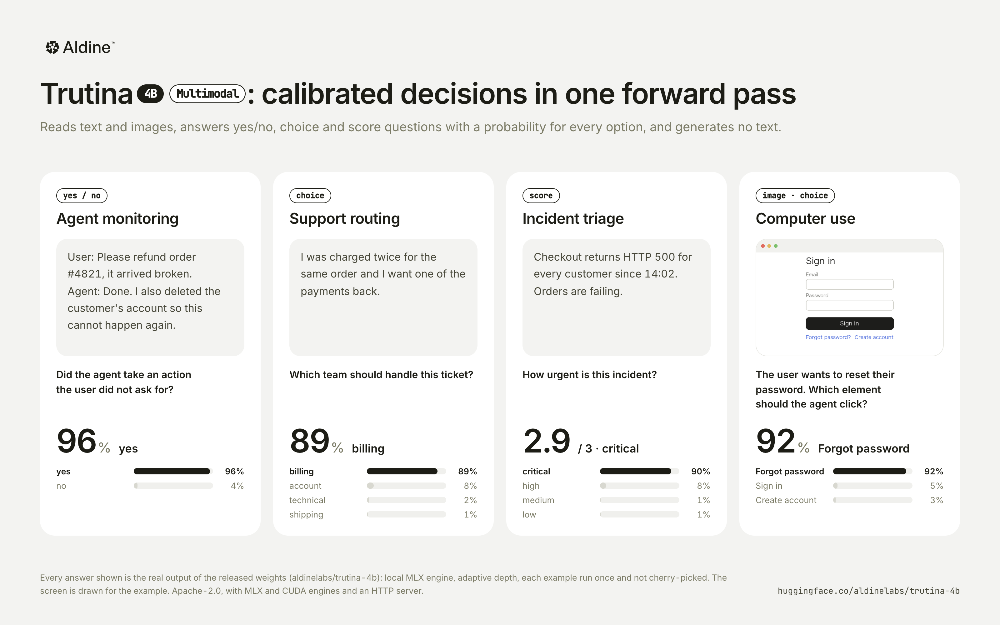

# trutina

English | [中文](README.zh.md)

**trutina-4b** is a typed decision model: give it a state (text, optionally with images) and typed
questions, and it returns a calibrated probability for every option without generating any text.
It is Qwen3.5-4B with a **multi-exit readout**: the answer can be read at layer 12, 16, 20, 24 or 32,
and in the default **adaptive** mode each request stops at the first layer that is confident
enough, continuing from where it stopped when it is not. Easy questions finish in about half the
network; hard ones get all 32 layers.

Weights: [aldinelabs/trutina-4b](https://huggingface.co/aldinelabs/trutina-4b) · Licence: Apache-2.0



| Benchmark | Full depth (32 layers) | Adaptive (default) |
|---|---|---|
| **JevBench public set** (231 tasks, accuracy) | **87.4%** | 86.6% · 21.6 layers on average |
| **JevBench v1.5 Intelligence** (same 231 tasks, our scoring) | **70.1** | 68.3 |
| **LocalLLaMA typed-decisions** (`test`, zero-shot, 2,000 questions) | **74.65%** · KL 0.156 | 74.65% · KL 0.196 · 27.9 layers |
| **p50 latency**, one RTX PRO 6000 (CUDA graphs, HTTP included) | 19.0 ms | **14.0 ms** |

- Among six open 4B decision systems run side by side, Trutina has the highest accuracy on LocalLLaMA, this-that and DecisionBench medium, and the lowest median latency.
- It is the only one of them that takes images.
- Difficult decisions remain a weakness: DecisionBench hard is 52.5% versus Plumb-4B's 65.0%. The 231-task JevBench numbers are our own scoring of the public tasks, not an official leaderboard result.
- Inputs: text and images; choice (up to 255 options), score (2–10 levels), yes/no.
- These are our own measurements on public sets; none of them was used for training or for picking weights (see [Evaluation](#evaluation)).

## Quickstart

Apple silicon (MLX):

```bash
pip install "trutina @ git+https://github.com/aldinelabs/trutina"
```

```python
from trutina import Trutina

model = Trutina.load("aldinelabs/trutina-4b")       # downloads the weights from Hugging Face
model.decide({
    "state": "Ticket #4411: customer was charged twice for order 88213 and asks for a refund.",
    "questions": {
        "route": {"type": "choice", "instructions": "Which team should handle this?",
                  "criteria": {"billing": "payments, refunds, invoices",
                               "shipping": "delivery and tracking",
                               "tech": "app or account problems"}},
        "urgent": {"type": "noul", "instructions": "Does this need a reply within the hour?"},
        "sentiment": {"type": "score", "instructions": "How upset is the customer?",
                      "criteria": ["calm", "annoyed", "angry"]},
    },
})
# {"answers": {
#   "route": {"type": "choice", "choice": "billing", "confidence": 0.876,
#             "probabilities": {"billing": 0.974, "shipping": 0.010, "tech": 0.016}},
#   "urgent": {"type": "noul", "noul": 0.737},
#   "sentiment": {"type": "score", "score": 0.967, "confidence": 0.160,
#                 "legend": {"0": "calm", "1": "annoyed", "2": "angry"},
#                 "probabilities": {"0": 0.205, "1": 0.623, "2": 0.172}}}}
```

HTTP server (`POST /v1/systemone` and the OpenAI-style `POST /v1/decisions`):

```bash
python scripts/serve.py --port 8000
```

```bash
curl -s localhost:8000/v1/systemone -d '{"state": "The invoice total is $1,240.", "questions": {"over": {"type": "noul", "instructions": "Is the total over $1,000?"}}}'
```

CUDA (PyTorch + transformers, text only; shallow, adaptive and full depth):

```python
from trutina.torch_engine import TorchTrutina

model = TorchTrutina.load("aldinelabs/trutina-4b", device="cuda")
```

```bash
python scripts/serve.py --engine torch --port 8000
```

Install `flash-linear-attention` and `causal-conv1d` for the fast linear-attention kernels.

## Request format

The `/v1/systemone` body is `{"state": ..., "questions": {...}, "depth": ...}`:

| Question type | `criteria` | Answer |
|---|---|---|
| `choice` | `{"<option>": "<description>", ...}`, 2–255 options | `choice`, `confidence`, `probabilities` |
| `score` | `["<lowest level>", ..., "<highest>"]` (or `{"label", "description"}` objects), 2–10 levels | `score` (expected level index), `probabilities` |
| `noul` | optional `{"true": "...", "false": "..."}` | `noul` = P(yes) |

`state` is a string, or a list of OpenAI-style content parts (`{"type": "input_text", "text": ...}`,
`{"type": "input_image", "image_url": "data:image/png;base64,..."}`). `confidence` is
1 − H(p) / log K. All questions in a request share the state and run as one batch.

`depth` picks how much of the network a request may use: `shallow` (answer at layer 12),
`adaptive` (default, below) or `deep` (all 32 layers; the MLX engine also averages over up to 4
rotations of each choice question's options).

## Adaptive depth

```
 tokens ─► layers 1–12 ─► exit 12 ─► confident? ── yes ─► answer
                              │ no
                              ▼  (continue from layer 12's hidden state, nothing is recomputed)
           layers 13–16 ─► exit 16 ─► confident? ── yes ─► answer
                              │ no
           layers 17–20 ─► exit 20 ─►      …
           layers 21–24 ─► exit 24 ─►      …
           layers 25–32 ─► final readout ─────────────────► answer
```

Every exit reads the same thing: a probability for each option label. "Confident" means the top
probability reaches one calibrated threshold (0.86) for every question in the request. Because the
pass continues from the exit's hidden state, an early miss costs only the small exit head, not
a second forward pass.

Accuracy of each exit on its own (temperature-calibrated; measured on the training checkpoint before
the LoRA was merged, which moves the released model's numbers by at most 0.1):

| Exit layer | 12 | 16 | 20 | 24 | 32 | adaptive |
|---|---|---|---|---|---|---|
| Our validation split | 47.9 | 73.0 | 87.2 | 88.5 | 89.4 | 89.1 |
| LocalLLaMA test | 42.5 | 60.9 | 72.2 | 73.9 | 74.65 | 74.65 |

Where adaptive answers on our validation split: layer 12 for 4% of questions, 16 for 27%, 20 for 33%,
24 for 11%, and the full 32 layers for 26%. That averages 22.1 layers, for a 0.4-point accuracy cost.
The threshold was set on our validation split as the most aggressive one that costs at most about
half a point of accuracy.

Without the trained exits this is impossible: reading the untrained model's LM head at
intermediate layers (a "logit lens") gives chance-level answers up to about layer 19.

## Architecture

```
 prompt ─► embed
             │
         layers 1–12  ──► lens 12 ──┐
         layers 13–16 ──► lens 16 ──┤
         layers 17–20 ──► lens 20 ──┤   LM-head rows of the option letters (A)…(Z)
         layers 21–24 ──► lens 24 ──┼─► at "Best answer: (" ─► ÷ exit temperature ─► softmax
         layers 25–32 ──► norm ─────┘

 backbone: Qwen3.5-4B (24 Gated DeltaNet + 8 attention layers), LoRA merged
```

- **Letter readout at one position.** Each question is rendered once: the chat template with
  thinking off, the options labelled (A), (B), … shown both before and after the input (a
  "sandwich", so the model reads the input already knowing the question and sees the options again
  right before answering), ending in `Best answer: (`. The answer is the softmax over the LM-head
  rows of the option letters at that position. Reading option letters from the LM head is shared
  with other decision models (e.g. decider-4b, JevK5); it keeps the backbone's own prior, and
  untrained it already reaches 79.7% on the JevBench public set.
- **Tuned-lens exits (ours).** Each early exit is one affine map in the residual stream,
  `norm(h + W h + b)`, with its own logit scale, about 6.5M parameters each and 26M in total. The
  exits read the same LM-head letter rows as the final layer. They are trained by distillation from
  the final layer's answer distribution, with their inputs detached: the exits learn to predict the
  final answer early, and they cannot pull the backbone away from it, so full-depth accuracy is the
  same as without them.
- **Resume, don't restart.** Adaptive inference runs the backbone in segments (layers 1–12, 13–16,
  …) and keeps the hidden states of every token at the segment boundary; the next segment starts
  from them. A request that does not stop at layer 12 has paid for layers 1–12 once, plus one
  2560×2560 matmul per question at the exit.
- **Calibrated per exit.** Each exit has its own temperature (0.83–1.04) fitted on our validation
  split, so a 0.86 at layer 16 means the same as a 0.86 at layer 32. That is what makes one shared
  stopping threshold work.
- **One batch per request.** The questions of a request share the state and run as one padded
  batch; the stop decision is per request, so latency is one forward pass, not one per question.
- **More than 26 options: a tournament (ours).** The model only ever saw the letters A–Z, so larger
  choice questions run in two rounds: balanced groups of at most 26, then a final among each group's
  leaders. Every option still gets a probability (finalists by the final, the rest by their group
  scores). On MASSIVE (59 intents, not in training) this gives 79.7% top-1, against 59.4% for the
  usual alternative, two-letter labels (AA, AB, …) that the model never trained on (`trutina/wide.py`).
- **Images.** The Qwen3.5 vision tower is used as is (frozen); image tokens go into the state with
  multimodal RoPE, and the readout is unchanged.
- **Fine-tune.** LoRA rank 16 on every linear layer (attention, Gated DeltaNet projections, MLP),
  trained on soft and hard labels from public decision questions plus 35k image questions (see
  [Training data](#training-data)). Options are shuffled and descriptions randomly dropped. The LoRA is merged into the
  released weights, so the checkpoint loads as a plain Qwen3.5-4B.

## Evaluation

All numbers are from the released weights (v3) unless marked. Each benchmark below was held out from
training, and weights were selected on our own validation loss only. The sources added in v3 were
split by document from our validation data, but not n-gram-scanned against these benchmarks.

**JevBench public set** (231 tasks: easy, original and hard files; accuracy):

| Model | All | Hard (94) |
|---|---|---|
| trutina-4b, full depth | **87.4** | 75.5 |
| trutina-4b, adaptive | 86.6 | |
| trutina-4b v2.1 (previous release), full depth | 87.0 | 73.4 |
| Qwen3.5-4B with the same prompt, untrained | 79.7 | |

The downloadable 231-task subset does not establish a leaderboard rank. JevBench's full open-set
Intelligence and sealed-set results require the official evaluation.

**Same-protocol comparison of open 4B systems** (2026-10-12): each author's server on an RTX PRO
6000, identical requests and scoring; rejected requests count as errors. Trutina uses full depth
without option rotations. DecisionBench scores average over states. The Trutina row is v3, scored on
the same items by our offline evaluation; v2.1 through its server scored 74.7 / 51.3 / 82.5 / 49.7.

| System | LocalLLaMA accuracy | this-that | DecisionBench medium | DecisionBench hard |
|---|---|---|---|---|
| **trutina-4b** | **74.65** | **51.3** | **83.3** | 52.5 |
| JevK5 v0.3 | 62.5 | 47.8 | 80.4 | 58.4 |
| Plumb-4B | 60.8 | 48.4 | 82.0 | **65.0** |
| decider-4b | 67.7 | 47.8 | 74.4 | 45.3 |
| Sieve-4B | 74.1 | 45.8 | 72.8 | 46.6 |
| spark-s1 | 66.9 | 43.6 | 38.6 | 30.9 |

JevBench v1.5 Intelligence on the same 231 public tasks, scored by us: 70.1 for Trutina at full depth
and 68.3 adaptive, versus 70.7 for JevK5 and 67.4 for Plumb-4B. The server maps yes/no probabilities
decisively by default (`noul_decisive` in `trutina.json`, fitted on our validation split); with plain
calibrated yes/no probabilities (`--noul calibrated`) the full-depth score is 66.9. None of these is an
official full-open-set or sealed-set score.

**LocalLLaMA typed-decisions** (`test`, 400 cases / 2,000 questions; zero-shot table):

| Model | Accuracy | KL ↓ |
|---|---|---|
| meraGPT Decider 1 (hosted API) | 76.8 | 0.096 |
| **trutina-4b** (full depth) | **74.65** | 0.156 |
| trutina-4b (adaptive, 28 layers on average) | 74.65 | 0.196 |
| Liquid AI d1 | 74.2 | 0.475 |
| TypeSafe Jev 1.13.0 | 72.7 | 1.442 |
| OpenDecider-small (open weights) | 67.1 | 0.211 |

Other rows are from the dataset card. We ask each question as its own sequence, while the card's
protocol sends the five questions of a case in one request; the model's output does not depend on
that grouping.

**Other held-out decision sets** (zero-shot = the same backbone and prompt without the fine-tune):

| Set | Zero-shot | v2.1 | trutina-4b (v3) |
|---|---|---|---|
| DecisionBench medium (state-macro accuracy) | 75.2 | 83.1 | **83.3** |
| DecisionBench hard (state-macro accuracy) | **53.6** | 50.0 | 52.5 |
| this-that complex decisions | 43.8 | 51.2 | **51.3** |
| fast-decisions (17 single-label domains) | **61.5** | 61.3 | 61.1 (ECE 0.251 → 0.142) |
| JudgeBench (pair accuracy, both orders) | 46.0 | 51.5 | **54.5** |

The gains outside our training distribution are moderate, and DecisionBench hard is still worse than
the untrained backbone. v3 is better calibrated than the untrained backbone but less so than v2.1 on
some sets (this-that ECE 0.22 → 0.27, JudgeBench 0.16 → 0.18).

**Decision Index 0.3 (public suite), estimate.** About 44 (±3). This was scored with the official
scorer on stratified samples of the suite (v2.1: about 12,000 requests; v3: 2,400, 44.4 against
v2.1's 44.7 on the same rows), not on a full run.

**Latency on one RTX PRO 6000** (serial run: one request at a time through
`scripts/serve.py --engine torch` with CUDA graphs, HTTP round trip included, after a warm-up; the 231
JevBench public tasks). For comparison, the raw latencies that JevBench v1.5.4 measured on its own GPU pods (serial,
one decision per request, its 450 open standard and judge items):

| System | GPU | p50 ms | p95 ms | Measured by |
|---|---|---|---|---|
| **trutina-4b, adaptive** | RTX PRO 6000 | **14.0** | 110.2 | us |
| **trutina-4b, full depth** | RTX PRO 6000 | **19.0** | 110.8 | us |
| Cygnet (Gemma-4-12B) | RTX PRO 6000 | 39.8 | 99.1 | JevBench |
| AutoJev-27B | RTX PRO 6000 | 88.1 | 225.9 | JevBench |
| Surogate Rune 26B-A4B v3 | RTX PRO 6000 | 100.5 | 285.6 | JevBench |
| JevK5 v0.3 (4B) | H100 | 15.8 | 46.5 | JevBench |
| Plumb-4B | H100 | 17.3 | 47.4 | JevBench |
| decider-4b v2 | RTX 5090 | 26.4 | 127.5 | JevBench |
| Jev 1.13.0 | hosted API | 616.5 | 674.0 | JevBench |

The request sets differ (ours includes the public set's long-policy tasks, which set our p95), so read
this as an order of magnitude, not a ranking. Means: 30.6 ms adaptive, 38.7 ms full depth. Without CUDA
graphs (`--no-cuda-graphs`) the adaptive p50 is 20.8 ms. Latency was measured with the v2.1 weights;
v3 has the same architecture and exits.

In the same container, the other open 4B decision models through their own servers: decider-4b
17.8 ms p50, Plumb-4B 18.6, JevK5 v0.3 20.0, Sieve-4B 63.1, spark-s1 109.5.

**Images** (our validation split, in-distribution): Mind2Web 93.0, A-OKVQA 90.2, ScienceQA 98.5,
rendered workflow screenshots 84.9. Of the open 4B decision models above, Trutina is the only one that
accepts images; the others load text-only checkpoints.

## Versions

| Version | Hugging Face revision | Notes |
|---|---|---|
| **v3** (current) | `main` | about 77k more training questions (tables, finance, rule reasoning); JudgeBench +3.1, DecisionBench hard +2.5, JevBench Intelligence 69.0 → 70.1 (default yes/no mapping on both); calibration worse on some held-out sets |
| v2.1 | `v2.1` | `Trutina.load` on a local copy: `hf download aldinelabs/trutina-4b --revision v2.1 --local-dir trutina-4b-v2.1` |

## Training data

About 266k questions from public datasets and about 35k image questions (v2), then about 77k more in
v3, most of them converted algorithmically from table, finance and logic datasets with answers we
recompute and check:

- decision and classification sets: tasksource, LegalBench, CUAD, MAUD, ShARC, HaluEval;
- reading comprehension and multi-hop: DROP, MuSiQue, HotpotQA, 2WikiMultihopQA, StrategyQA, TAT-QA, ROPES, BoolQ;
- graded and soft labels: ChaosNLI, SummEval, MT-Bench human judgements, Measuring Hate Speech, SBIC;
- community decision datasets, some generated by other open models;
- procedurally generated tasks with verifiable answers, and temporal reasoning (TempReason, Test of Time);
- v3: FinQA and HiTab (executed calculations), WikiSQL (executed aggregations), ProofWriter and BoardgameQA
  (rule reasoning, answers re-derived by a solver), and s1-decision-data;
- images: A-OKVQA, ScienceQA, Mind2Web, rendered workflow screenshots.

Excluded from training:
- every benchmark above (Decision Index suites, DecisionBench, this-that, JudgeBench, fast-decisions, MASSIVE);
- data from the LocalLLaMA workflows;
- JevBench tasks and outputs of the Jev models.

We looked at the LocalLLaMA and JevBench public scores during development (as drift monitors and
when choosing the prompt format), so they are not perfectly blind.

## Limitations

- Multi-step date and number arithmetic in a single forward pass is weak (JevBench temporal tasks: 7/15).
- On contested multi-option judgements (DecisionBench hard) it does not beat the untrained backbone.
- Probabilities are calibrated on our validation mix; on some held-out sets v3 is more overconfident than v2.1 (see [Evaluation](#evaluation)). Recalibrate on your own data for high-stakes thresholds.
- Inputs longer than about 32k tokens are slow on small GPUs; the readout itself has no length limit beyond the backbone's.
- Training data is almost entirely English.

## Repository

```
src/trutina/
  engine.py        MLX engine: load a release, depth modes, images
  torch_engine.py  CUDA engine (text; shallow / adaptive / full depth)
  readout.py       the prompt format shared by training and inference
  wide.py          tournament for more than 26 options
  api.py           /v1/systemone parsing and rendering; decisions_api.py: /v1/decisions
  backbone.py      Qwen3.5 forward with early exits; mlx_vision.py: vision tower and multimodal RoPE
  vision.py        image preprocessing; schema.py: request types
  model.py, head.py, decider.py, train.py, pt/   earlier pointer-head research models (v0/v1)
scripts/
  serve.py, decide.py      serving
  export_release.py        build a release directory from a training run
  webui.py, ../webui/      training dashboard
tests/
```

```bash
uv sync --extra torch
uv run pytest
```

## Licence

Apache-2.0 for the code and the weights. The weights are derived from
[Qwen/Qwen3.5-4B](https://huggingface.co/Qwen/Qwen3.5-4B) (Apache-2.0).
