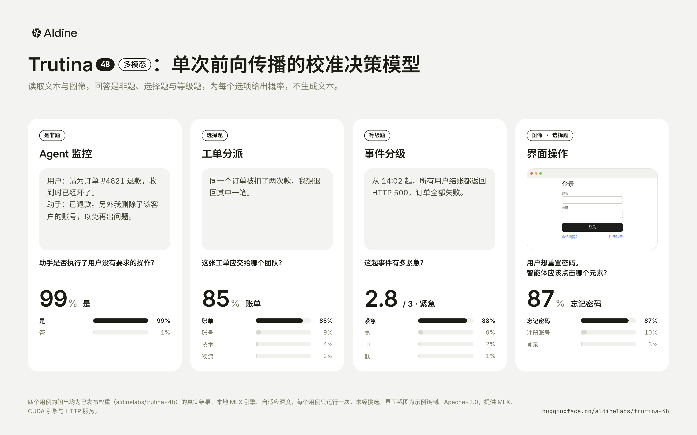

# trutina

[English](README.md) | 中文

**trutina-4b** 是一个类型化决策模型（typed decision model）。模型的输入为一段状态描述（state，文本，可包含图像）及若干带类型的问题，输出为每个候选项上经过校准的概率分布；整个过程不生成文本。
该模型以 Qwen3.5-4B 为骨干，引入了**多出口读出（multi-exit readout）**机制，可在第 12、16、20、24 或 32 层给出答案。在默认的**自适应深度（adaptive）**模式下，每个请求在首个置信度达到阈值的出口处终止计算；若未达到阈值，则从该层的隐状态继续向后计算。对于较简单的问题，模型约使用一半的层数；对于较困难的问题，则使用全部 32 层。

权重：[aldinelabs/trutina-4b](https://huggingface.co/aldinelabs/trutina-4b) · 博客：[隆重推出 Trutina 4B](https://aldine.cn/zh/journal/introducing-trutina/) · [技术报告](https://aldine.cn/zh/journal/trutina-technical-report/) · 论文：[doi:10.5281/zenodo.23403860](https://doi.org/10.5281/zenodo.23403860) · 许可证：Apache-2.0



| 基准 | 完整深度（32 层） | 自适应深度（默认） |
|---|---|---|
| **JevBench 公开集**（231 题，准确率） | **87.4%** | 86.6% · 平均 21.6 层 |
| **JevBench v1.5 Intelligence**（同 231 题，自行计分） | **70.1** | 68.3 |
| **LocalLLaMA typed-decisions**（`test` 划分，零样本，2,000 题） | **74.65%** · KL 0.156 | 74.65% · KL 0.196 · 平均 27.9 层 |
| **p50 延迟**，单张 RTX PRO 6000（CUDA graph，含 HTTP） | 19.0 ms | **14.0 ms** |

- 在六个开放 4B 决策系统的同场对比中，Trutina 在 LocalLLaMA、this-that 和 DecisionBench medium 上准确率最高，中位延迟最低。
- 它也是其中唯一支持图像输入的模型。
- 难题仍是短板：DecisionBench hard 为 52.5%，Plumb-4B 为 65.0%。231 道 JevBench 公开题的分数是我们自行计分的结果，不是官方榜单成绩。
- 支持的输入为文本与图像；支持的题型为选择题（choice，最多 255 个选项）、等级评分题（score，2–10 级）和是非题（noul）。
- 以上结果均为我们在公开数据上的自测结果，这些数据集既未用于训练，也未用于权重选择（详见[评测](#评测)）。

## 快速上手

Apple silicon（MLX）：

```bash
pip install "trutina @ git+https://github.com/aldinelabs/trutina"
```

```python
from trutina import Trutina

model = Trutina.load("aldinelabs/trutina-4b")       # 从 Hugging Face 下载权重
model.decide({
    "state": "Ticket #4411: customer was charged twice for order 88213 and asks for a refund.",
    "questions": {
        "route": {"type": "choice", "instructions": "Which team should handle this?",
                  "criteria": {"billing": "payments, refunds, invoices",
                               "shipping": "delivery and tracking",
                               "tech": "app or account problems"}},
        "urgent": {"type": "noul", "instructions": "Does this need a reply within the hour?"},
        "sentiment": {"type": "score", "instructions": "How upset is the customer?",
                      "criteria": ["calm", "annoyed", "angry"]},
    },
})
# {"answers": {
#   "route": {"type": "choice", "choice": "billing", "confidence": 0.876,
#             "probabilities": {"billing": 0.974, "shipping": 0.010, "tech": 0.016}},
#   "urgent": {"type": "noul", "noul": 0.737},
#   "sentiment": {"type": "score", "score": 0.967, "confidence": 0.160,
#                 "legend": {"0": "calm", "1": "annoyed", "2": "angry"},
#                 "probabilities": {"0": 0.205, "1": 0.623, "2": 0.172}}}}
```

HTTP 服务（`POST /v1/systemone`，以及兼容 OpenAI 风格的 `POST /v1/decisions`）：

```bash
python scripts/serve.py --port 8000
```

```bash
curl -s localhost:8000/v1/systemone -d '{"state": "The invoice total is $1,240.", "questions": {"over": {"type": "noul", "instructions": "Is the total over $1,000?"}}}'
```

CUDA（PyTorch + transformers，支持 shallow、adaptive 与 deep 三种深度）：

```python
from trutina.torch_engine import TorchTrutina

model = TorchTrutina.load("aldinelabs/trutina-4b", device="cuda")
```

```bash
python scripts/serve.py --engine torch --port 8000
```

安装 `flash-linear-attention` 与 `causal-conv1d` 后，线性注意力层将使用优化的 CUDA kernel。
加载时传入 `vision=True`（服务端：`--vision`）可启用图像输入。

**ROCK 5B / ARM CPU（16GB，已实测）：**

```bash
python scripts/serve.py --engine torch --device cpu --cpu-int8 --vision \
  --threads 4 --batch-tokens 512 --model /path/to/trutina-4b
```

CPU 后端支持文本、图像及全部深度模式。ROCK 5B 上一个短文本 adaptive 样例实测约 7.9 秒；这不是基准延迟分布。
另提供 RK3588 的 RKLLM NPU 后端与权重导出脚本：相同发票样例的完整深度读出约 2.1 秒。
`--engine rock5` 将 NPU 文本完整深度与 CPU 图像、中间出口接入同一服务，一次只保留一个模型；切换后端包含重新加载时间。
实验性的 `--npu-matmul` 后端将解码器 Linear 层交给 NPU，保留真正的 adaptive 提前退出，文本和图像共用同一个驻留模型。
参见[安装流程、实测记录与 NPU 限制](docs/rock5.md)。

## 请求格式

`/v1/systemone` 的请求体为 `{"state": ..., "questions": {...}, "depth": ...}`：

| 题型 | `criteria` | 返回字段 |
|---|---|---|
| `choice` | `{"<选项>": "<描述>", ...}`，2–255 个选项 | `choice`、`confidence`、`probabilities` |
| `score` | `["<最低等级>", ..., "<最高等级>"]`（或 `{"label", "description"}` 对象），2–10 级 | `score`（等级的期望值）、`probabilities` |
| `noul` | 可选，`{"true": "...", "false": "..."}` | `noul` = P(yes) |

`state` 可以是字符串，也可以是 OpenAI 风格的内容片段列表（`{"type": "input_text", "text": ...}`、`{"type": "input_image", "image_url": "data:image/png;base64,..."}`）。`confidence` 定义为 1 − H(p) / log K。同一请求中的全部问题共享同一 state，并作为一个批次统一计算。

`depth` 规定单个请求可使用的最大层数：`shallow`（在第 12 层作答）、`adaptive`（默认，见下节）或 `deep`（使用全部 32 层；在 MLX 引擎上，还会对每道选择题的选项顺序做至多 4 次循环轮换并对结果取平均）。

## 自适应深度

```
 tokens ─► 第 1–12 层 ─► 出口 12 ─► 达到阈值？ ── 是 ─► 输出
                             │ 否
                             ▼  （沿用第 12 层的隐状态继续计算，不重复计算）
           第 13–16 层 ─► 出口 16 ─► 达到阈值？ ── 是 ─► 输出
                             │ 否
           第 17–20 层 ─► 出口 20 ─►      …
           第 21–24 层 ─► 出口 24 ─►      …
           第 25–32 层 ─► 最终读出 ──────────────────► 输出
```

各出口读取的是同一组量，即各选项标签的概率。终止条件为：请求中每道题的最大类别概率均不低于同一个经校准的阈值（0.86）。由于后续计算沿用出口处的隐状态，未在早期出口终止的请求仅额外承担一个小型出口头的计算，而无需重新执行前向传播。

各出口单独作答时的准确率（经温度校准；在合并 LoRA 之前的训练检查点上测得，与合并后的发布权重相差不超过 0.1）：

| 出口层 | 12 | 16 | 20 | 24 | 32 | 自适应 |
|---|---|---|---|---|---|---|
| 验证集 | 47.9 | 73.0 | 87.2 | 88.5 | 89.4 | 89.1 |
| LocalLLaMA test | 42.5 | 60.9 | 72.2 | 73.9 | 74.65 | 74.65 |

自适应深度在验证集上的终止层分布为：第 12 层 4%，第 16 层 27%，第 20 层 33%，第 24 层 11%，第 32 层 26%。平均使用 22.1 层，准确率下降 0.4 个百分点。阈值在验证集上确定：在准确率下降不超过约 0.5 个百分点的约束下，取计算量最小的阈值。

这一性质依赖于经过训练的出口。若在未经训练的模型中间层直接应用 LM head（即 logit lens），在约第 19 层之前，准确率与随机猜测相当。

## 架构

```
 prompt ─► embed
             │
         第 1–12 层  ──► lens 12 ──┐
         第 13–16 层 ──► lens 16 ──┤
         第 17–20 层 ──► lens 20 ──┤   LM head 中选项字母 (A)…(Z) 对应的行
         第 21–24 层 ──► lens 24 ──┼─► 在 "Best answer: (" 位置读出 ─► ÷ 出口温度 ─► softmax
         第 25–32 层 ──► norm ─────┘

 骨干：Qwen3.5-4B（24 层 Gated DeltaNet + 8 层注意力），LoRA 已合并
```

- **单位置的选项字母读出。** 每道题渲染为一条序列：使用 chat template（关闭 thinking），选项标记为 (A)、(B)……，问题在输入的前后各出现一次（"三明治"结构：模型在读取输入时已知问题，作答前可再次读取选项），序列以 `Best answer: (` 结尾。答案为该位置上 LM head 中各选项字母所对应行的 softmax。从 LM head 读取选项字母的做法与其他决策模型（如 decider-4b、JevK5）一致；该做法保留了骨干模型自身的先验，未经训练即可在 JevBench 公开集上取得 79.7% 的准确率。
- **Tuned-lens 出口（本工作提出）。** 每个早期出口是作用于残差流的仿射变换 `norm(h + W h + b)`，并配有独立的 logit 缩放系数；每个出口约 650 万参数，合计约 2600 万。各出口与最后一层共用 LM head 中的字母行。训练目标为蒸馏最后一层的答案分布，且出口的输入经过梯度截断（detach）：出口学习提前预测最终答案，但不会改变骨干网络的表示，因此完整深度下的准确率与不加出口时一致。
- **续算而非重算。** 自适应推理将骨干网络分段执行（第 1–12 层、第 13–16 层等），保留各 token 在分段边界处的隐状态，下一段由此继续。未在第 12 层终止的请求，其第 1–12 层只计算一次，额外开销仅为每道题在出口处的一次 2560×2560 矩阵乘法。
- **逐出口校准。** 每个出口有独立的温度系数（0.83–1.04），在验证集上拟合，因此第 16 层的 0.86 与第 32 层的 0.86 具有相同的含义。这是单一共享终止阈值得以成立的前提。
- **按请求批处理。** 同一请求中的问题共享 state，作为一个填充后的批次统一计算；终止判断以整个请求为单位，因此单个请求的延迟对应一次前向传播，而非每题一次。
- **超过 26 个选项时的分组淘汰（本工作提出）。** 模型训练时只使用字母 A–Z 作为标签，因此选项更多的选择题分两轮处理：先将选项均分为若干组（每组不超过 26 个），再由各组的领先选项进入决赛。每个选项仍有对应概率（进入决赛的选项按决赛结果计算，其余按组内得分计算）。在 MASSIVE（59 个意图类别，未用于训练）上，该方法的 top-1 准确率为 79.7%；作为对照，常见的双字母标签方案（AA、AB……，模型未经此类训练）为 59.4%（见 `trutina/wide.py`）。
- **图像输入。** 直接使用 Qwen3.5 的视觉编码器（参数冻结），图像 token 置于 state 中，配合多模态 RoPE，读出方式保持不变。
- **微调。** 在所有线性层（注意力、Gated DeltaNet 投影与 MLP）上施加秩为 16 的 LoRA，使用公开决策题与约 3.5 万道图像题的软标签和硬标签进行训练（见[训练数据](#训练数据)）；训练中随机打乱选项顺序，并随机删去选项描述。LoRA 已合并入发布权重，因此该检查点可按标准 Qwen3.5-4B 加载。

## 评测

除特别说明外，以下结果均基于发布权重（v3）。下列基准均未参与训练，权重选择仅依据我们自己的验证集损失。v3 新增的数据来源按文档与验证集隔离，但未针对这些基准做 n-gram 重叠扫描。

**JevBench 公开集**（231 题，含 easy、original、hard 三个文件；指标为准确率）：

| 模型 | 全部 | Hard（94 题） |
|---|---|---|
| trutina-4b，完整深度 | **87.4** | 75.5 |
| trutina-4b，自适应深度 | 86.6 | |
| trutina-4b v2.1（上一版），完整深度 | 87.0 | 73.4 |
| Qwen3.5-4B，相同 prompt，未微调 | 79.7 | |

可下载的 231 题子集不能确定榜单排名。完整公开集的 Intelligence 与封闭集结果需要由 JevBench 官方评测。

**开放 4B 系统的同口径比较**（2026-10-12）：各系统使用作者提供的服务端，在 RTX PRO 6000 上接收相同请求并使用相同计分；拒绝的请求计为错误。Trutina 使用完整深度、不轮换选项。DecisionBench 按 state 宏平均计分。Trutina 一行为 v3，由我们的离线评测在相同题目上计分；v2.1 经服务端测得 74.7 / 51.3 / 82.5 / 49.7。

| 系统 | LocalLLaMA 准确率 | this-that | DecisionBench medium | DecisionBench hard |
|---|---|---|---|---|
| **trutina-4b** | **74.65** | **51.3** | **83.3** | 52.5 |
| JevK5 v0.3 | 62.5 | 47.8 | 80.4 | 58.4 |
| Plumb-4B | 60.8 | 48.4 | 82.0 | **65.0** |
| decider-4b | 67.7 | 47.8 | 74.4 | 45.3 |
| Sieve-4B | 74.1 | 45.8 | 72.8 | 46.6 |
| spark-s1 | 66.9 | 43.6 | 38.6 | 30.9 |

在相同的 231 道公开题上按 JevBench v1.5 Intelligence 自行计分：Trutina 完整深度 70.1、自适应深度 68.3，JevK5 为 70.7，Plumb-4B 为 67.4。服务端默认对是非题概率做决断映射（`trutina.json` 中的 `noul_decisive`，在验证集上拟合）；改用纯校准概率（`--noul calibrated`）时完整深度为 66.9。以上均不是官方完整公开集或封闭集的得分。

**LocalLLaMA typed-decisions**（`test` 划分，400 个 case，共 2,000 题；零样本榜单）：

| 模型 | 准确率 | KL ↓ |
|---|---|---|
| meraGPT Decider 1（托管 API） | 76.8 | 0.096 |
| **trutina-4b**（完整深度） | **74.65** | 0.156 |
| trutina-4b（自适应深度，平均 28 层） | 74.65 | 0.196 |
| Liquid AI d1 | 74.2 | 0.475 |
| TypeSafe Jev 1.13.0 | 72.7 | 1.442 |
| OpenDecider-small（开放权重） | 67.1 | 0.211 |

其余各行取自数据集卡片。我们将每道题作为独立序列处理；数据集卡片的协议为将同一 case 的五道题置于一个请求中发送。本模型的输出不受这种分组方式的影响。

**其他 held-out 决策数据集**（零样本基线指相同骨干与相同 prompt、不经微调）：

| 数据集 | 零样本基线 | v2.1 | trutina-4b（v3） |
|---|---|---|---|
| DecisionBench medium（按 state 宏平均的准确率） | 75.2 | 83.1 | **83.3** |
| DecisionBench hard（按 state 宏平均的准确率） | **53.6** | 50.0 | 52.5 |
| this-that complex decisions | 43.8 | 51.2 | **51.3** |
| fast-decisions（17 个单标签领域） | **61.5** | 61.3 | 61.1（ECE 0.251 → 0.142） |
| JudgeBench（两种选项顺序均判断正确方计为正确） | 46.0 | 51.5 | **54.5** |

在训练分布之外，微调带来的提升幅度有限；在 DecisionBench hard 上，微调后的模型仍低于未微调的骨干模型。v3 的校准好于未微调的骨干模型，但在部分数据集上不如 v2.1（this-that ECE 0.22 → 0.27，JudgeBench 0.16 → 0.18）。

**Decision Index 0.3（公开套件），估计值。** 约 44（±3）。该数值使用官方评分程序，在套件的分层抽样上计算（v2.1 约 1.2 万条请求；v3 为 2,400 条，同一批题目上 44.4，v2.1 为 44.7），并非完整评测的结果。

**单张 RTX PRO 6000 上的延迟**（串行，每次一个请求，经 `scripts/serve.py --engine torch`，启用 CUDA graph，包含 HTTP 往返，预热后测量；使用 JevBench 公开集的 231 题）。作为参照，下表同时列出 JevBench v1.5.4 在其自有 GPU 节点上测得的原始延迟（串行，每个请求包含一个判断，使用其 450 道公开 standard 与 judge 题）：

| 系统 | GPU | p50 ms | p95 ms | 测量方 |
|---|---|---|---|---|
| **trutina-4b，自适应深度** | RTX PRO 6000 | **14.0** | 110.2 | 本文 |
| **trutina-4b，完整深度** | RTX PRO 6000 | **19.0** | 110.8 | 本文 |
| Cygnet（Gemma-4-12B） | RTX PRO 6000 | 39.8 | 99.1 | JevBench |
| AutoJev-27B | RTX PRO 6000 | 88.1 | 225.9 | JevBench |
| Surogate Rune 26B-A4B v3 | RTX PRO 6000 | 100.5 | 285.6 | JevBench |
| JevK5 v0.3（4B） | H100 | 15.8 | 46.5 | JevBench |
| Plumb-4B | H100 | 17.3 | 47.4 | JevBench |
| decider-4b v2 | RTX 5090 | 26.4 | 127.5 | JevBench |
| Jev 1.13.0 | 托管 API | 616.5 | 674.0 | JevBench |

两组测量所用的请求集不同（本文的请求集包含公开集中较长的政策文档类题目，p95 主要由这些题目决定），因此该表仅用于比较数量级，不构成排名。平均延迟：自适应深度 30.6 ms，完整深度 38.7 ms。不启用 CUDA graph（`--no-cuda-graphs`）时，自适应深度的 p50 为 20.8 ms。延迟用 v2.1 权重测得，v3 的架构与出口相同。

同一容器内，其他开放 4B 决策模型经各自服务端的 p50：decider-4b 17.8 ms，Plumb-4B 18.6，JevK5 v0.3 20.0，Sieve-4B 63.1，spark-s1 109.5。

**图像任务**（我们的验证集，属于训练同分布数据）：Mind2Web 93.0，A-OKVQA 90.2，ScienceQA 98.5，渲染的工作流截图 84.9。在上述开放 4B 决策模型中，只有 Trutina 接受图像输入，其余模型加载的都是纯文本权重。

## 版本

| 版本 | Hugging Face revision | 说明 |
|---|---|---|
| **v3**（当前） | `main` | 新增约 7.7 万道训练题（表格、金融、规则推理）；JudgeBench +3.1，DecisionBench hard +2.5，JevBench Intelligence 69.0 → 70.1（两者均使用默认的是非题映射）；部分 held-out 数据集上校准变差 |
| v2.1 | `v2.1` | 下载到本地后用 `Trutina.load` 加载：`hf download aldinelabs/trutina-4b --revision v2.1 --local-dir trutina-4b-v2.1` |

## 训练数据

v2 使用约 26.6 万道来自公开数据集的题目与约 3.5 万道图像题；v3 再加入约 7.7 万道，大部分由表格、金融与逻辑数据集经算法转换而来，答案由我们重新计算并校验：

- 决策与分类：tasksource、LegalBench、CUAD、MAUD、ShARC、HaluEval；
- 阅读理解与多跳推理：DROP、MuSiQue、HotpotQA、2WikiMultihopQA、StrategyQA、TAT-QA、ROPES、BoolQ；
- 等级标签与软标签：ChaosNLI、SummEval、MT-Bench 人工评判、Measuring Hate Speech、SBIC；
- 社区决策数据集，其中部分由其他开源模型生成；
- 程序化生成、答案可验证的任务，以及时间推理数据（TempReason、Test of Time）；
- v3：FinQA 与 HiTab（执行计算）、WikiSQL（执行聚合）、ProofWriter 与 BoardgameQA（规则推理，答案由求解器重新推导），以及 s1-decision-data；
- 图像：A-OKVQA、ScienceQA、Mind2Web、渲染的工作流截图。

以下数据未用于训练：
- 上文列出的全部基准（Decision Index 各套件、DecisionBench、this-that、JudgeBench、fast-decisions、MASSIVE）；
- 来源于 LocalLLaMA 工作流的数据；
- JevBench 的题目及 Jev 系列模型的输出。

在开发过程中，我们查看过 LocalLLaMA 与 JevBench 公开集的分数（用于监测性能漂移以及选择 prompt 格式），因此这两项评测并非严格意义上的盲测。

## 局限性

- 在单次前向传播中完成多步日期与数值运算的能力较弱（JevBench 时间类题目：7/15）。
- 在存在争议的多选判断任务（DecisionBench hard）上，表现低于未微调的骨干模型。
- 概率按我们验证集的分布校准；在部分 held-out 数据集上，v3 比 v2.1 更过度自信（见[评测](#评测)）。若用于高风险场景下的阈值决策，建议在目标数据上重新校准。
- 在显存较小的 GPU 上，超过约 3.2 万 token 的输入推理速度较慢；读出机制本身除骨干模型的上下文长度外无其他长度限制。
- 训练数据几乎全部为英文。

## 仓库结构

```
src/trutina/
  engine.py        MLX 引擎：加载发布权重、深度模式、图像输入
  torch_engine.py  CUDA / ARM CPU 引擎（可选图像；全部深度模式）
  rkllm_engine.py  RK3588 NPU 引擎（完整深度文本读出）
  rock5_engine.py  统一服务：NPU 文本完整深度、CPU 出口/图像；单模型驻留
  readout.py       训练与推理共用的 prompt 格式
  wide.py          超过 26 个选项时的分组淘汰
  api.py           /v1/systemone 的解析与输出；decisions_api.py：/v1/decisions
  backbone.py      支持早退出的 Qwen3.5 前向；mlx_vision.py：视觉编码器与多模态 RoPE
  vision.py        图像预处理；schema.py：请求类型
  model.py, head.py, decider.py, train.py, pt/   早期 pointer-head 研究模型（v0/v1）
scripts/
  serve.py, decide.py      推理服务
  export_release.py        由训练产物构建发布目录
  webui.py, ../webui/      训练与评测看板
tests/
```

```bash
uv sync --extra torch
uv run pytest
```

## 许可证

代码与权重均采用 Apache-2.0 许可证。权重派生自 [Qwen/Qwen3.5-4B](https://huggingface.co/Qwen/Qwen3.5-4B)（Apache-2.0）。
